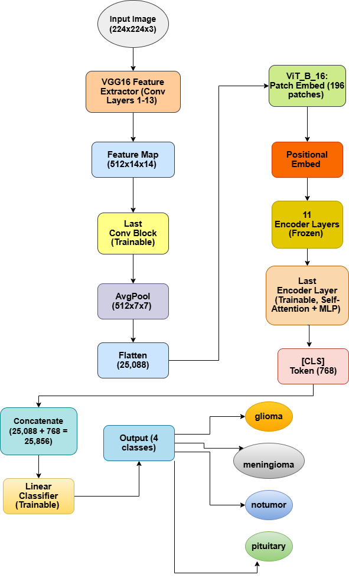

# Brain tumour MRI classification

Two hybrid deep learning models that classify a brain MRI scan as glioma, meningioma, pituitary tumour or no tumour. Each model runs a VGG network and a vision transformer (ViT-B/16) side by side on the same image and joins their features before the classifier, so local texture and global structure both contribute.

## Data

The Kaggle brain tumour MRI dataset, four classes. After removing corrupted files:

| Split | Images | Glioma | Meningioma | No tumour | Pituitary |
| --- | --- | --- | --- | --- | --- |
| Training | 5,700 | 1,315 | 1,339 | 1,590 | 1,456 |
| Testing | 1,308 | | | | |

Images are resized to 224 x 224 and normalised with ImageNet statistics. Training images get a random rotation of up to 10 degrees. A `SafeImageFolder` wrapper verifies every file with PIL on load and skips the corrupted ones.

## Models

Both models use ImageNet-pretrained weights and fine-tune only the last layers.

1. **VGG branch.** Convolutional features, 512 x 7 x 7 after pooling, flattened to 25,088 values. Only the last convolutional block is trainable.
2. **ViT-B/16 branch.** 196 patches through 12 encoder layers; the 768-value class token is kept. Only the last encoder layer is trainable.
3. **Fusion.** The two vectors are concatenated (25,856 values) and passed to a linear classifier over the four classes.

The second model swaps VGG16 for VGG19: [diagram](docs/hybrid-vgg19-vit.png).

## Training

PyTorch on a GPU, 30 epochs, batch size 32. Adam (learning rate 0.001, weight decay 1e-4) with a step schedule (x0.1 every 5 epochs), class-weighted cross-entropy for the mild class imbalance, mixed precision, and gradient accumulation over 2 batches. The best checkpoint by validation loss is kept.

## Results

| Model | Training accuracy | Best validation accuracy | Validation loss |
| --- | --- | --- | --- |
| VGG16 + ViT-B/16 | 99.79% | **98.62%** | 0.053 |
| VGG19 + ViT-B/16 | 99.54% | 98.47% | 0.058 |

Validation was run on the 1,308-image testing split, and the checkpoint was chosen on that same split, so these figures are slightly optimistic compared with a separate untouched test set. Per-class F1 is between 0.97 and 1.00; the most common error is glioma predicted as meningioma. Grad-CAM heatmaps were used to check that the models attend to the tumour region.

## What is in this repository

| File | Purpose |
| --- | --- |
| `data_exploration.ipynb` | Class counts, sample images and image statistics for the dataset |
| `docs/` | Architecture diagrams of both hybrid models |

The hybrid training notebook was run on Kaggle and is not in this repository yet. The dataset and trained weights are not stored here.

## Limits

A research project on one public dataset. It has not been validated on scans from other scanners or hospitals and is not a diagnostic tool.

## Author

Muhammad Umer Khan, [Neurals Solutions](https://neuralssolutions.com)

## License

MIT. See [LICENSE](LICENSE).
